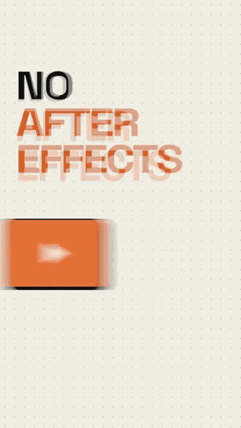
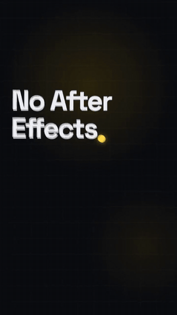

# Examples

## Launch Reel for this repo (9:16, 26 s)

<a href="../examples/launch-reel-raea.mp4"></a>

[Watch with sound (MP4)](../examples/launch-reel-raea.mp4)

Made with one request:

```
/motion-film https://github.com/s-azizkhan/motion-film-skill "Repo reel: launch reel" --format 9:16
```

- **Hook:** "You don't need After Effects to make this." (scored 80.8 in the hook lab), echoed in the last line so the Reel loops.
- **Carry:** one orange card runs through every scene: it whips in, becomes the terminal, the name card and the motion-blur demo.
- **Sound:** 55 cues, one per on-screen action, over a music bed that ducks under the voice; -14.7 LUFS.
- **Motion blur:** rendered through `shutter.sh`, 11 min on an M1 Pro.
- **Checks:** raea's export check found no errors; the slideshow checker passed the stills leg and asked for the shutter render (peak 586 px/frame).

## Same script, a second look (9:16, 26 s)

<a href="../examples/launch-reel-one-dot.mp4"></a>

[Watch with sound (MP4)](../examples/launch-reel-one-dot.mp4)

The same voice-over, hook and sound pipeline from motion-film, with the picture built as a single "one dot is the whole film" concept: the dot is the headline's full stop, the caret that types the command, the dot on the i in "motion-film", the 25 sounds, the FAIL stamp, the render bar and the dot on the i in the "film" comment. This picture was drawn in a canvas composition and rendered with the onetake renderer (a separate, noncommercial project) for comparison; it is not part of this repo.
